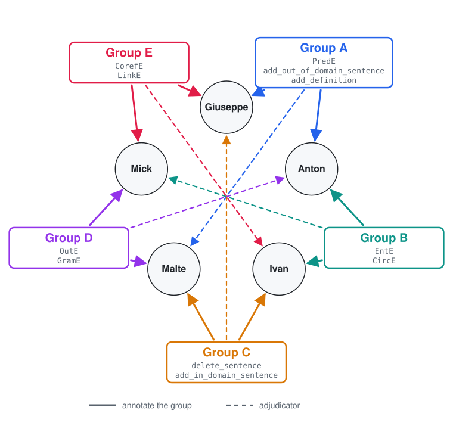

# Annotation proposal

A suggestion for how we check a part of the injected summaries by hand. Open for discussion.

## Why we need it

The model sometimes makes two changes instead of one, makes a change of the wrong type, or sets the wrong severity. If we test judges on such outputs, we can't say what the judge reacted to. So we look at a part of the outputs ourselves and write down what we see. Neha asked for this on 11.11.: a small subset, two people per output, so we can report how often we agree.

## How others did it

| Paper | What they checked | Who | Agreement |
|---|---|---|---|
| FRANK (Pagnoni et al., 2021) | every sentence: factual or not, then the error type | 3 crowd workers per summary, with a training and a test first | κ = 0.58 for factual or not, κ = 0.39 for the error type |
| APPLS (Guo et al., 2024) | 100 sampled pairs, rated on 5-point scales | 2 annotators, each rated all 100 | κ = 0.48 |
| BUMP (Ma et al., 2023) | every edited summary: is the edit valid and of the asked type | workers after a short test, then the authors | not reported; 16% had the wrong type |
| SummEdits (Laban et al., 2023) | edited summaries: consistent or not | 2 annotators after warm-up exercises | about 0.9 |

What we take from them:

- A sample is enough. APPLS checked 100 pairs, not the whole set.
- Two people per output is normal for a small team.
- Simple questions get higher agreement. Yes or no works better than a scale. FRANK tried rating whole summaries on a scale first and dropped it, because people agreed less.
- Agreement of about 0.4 to 0.6 is common. It will be lowest for severity.

## What we annotate

55 outputs: 5 from each of the 11 error types, drawn at random from the week-3 outputs.

The error types are split into five groups. Each group is annotated by two people, and both annotate all of it. A third person, the adjudicator, settles the answers where the two differ (see Steps). So everybody annotates two groups, adjudicates one, and works on one error type at a time.

| Group | Error types | Outputs | Annotated by | Adjudicator |
|---|---|---|---|---|
| A | PredE, add_out_of_domain_sentence, add_definition | 15 | Giuseppe, Anton | Malte |
| B | EntE, CircE | 10 | Anton, Ivan | Mick |
| C | delete_sentence, add_in_domain_sentence | 10 | Ivan, Malte | Giuseppe |
| D | OutE, GramE | 10 | Malte, Mick | Anton |
| E | CorefE, LinkE | 10 | Mick, Giuseppe | Ivan |

| Person | Annotates | Outputs | Adjudicates |
|---|---|---|---|
| Giuseppe | A, E | 25 | C |
| Malte | C, D | 20 | A |
| Anton | A, B | 25 | D |
| Mick | D, E | 20 | B |
| Ivan | B, C | 20 | E |

Left out: outputs where the model made no change, the week-2 test outputs, and one output with an English summary (item 1408, mistral-nemo).

## What the annotator sees

- the article
- the original summary
- the modified summary, with the changed words marked
- the error type the model was asked for

Hidden: the severity the model was asked for and who generated the output. Otherwise we copy the model's label.

## The four questions

| # | Question | Answers |
|---|---|---|
| 1 | How many changes are there? | one / none / more than one |
| 2 | Is the change of the asked error type? | yes / no / unclear |
| 3 | Is the changed part correct German? | yes / no |
| 4 | How severe is the error? | low / medium / high |

Notes:

- Question 1: several words can be one change, if they belong to one error ("fordert" → "lehnt … ab"). A second, unrelated edit counts as "more than one".
- Question 2: for faithfulness types, the changed statement must also be wrong compared to the article. A weaker but still true statement ("zerstört" → "beschädigt") is "no".
- Question 3 is not asked for GramE, where the German is wrong on purpose.
- Question 4 uses the definitions in `Taxonomy.md`: high changes the main claim, medium is a wrong secondary fact, low is a small detail. For coverage types: how important is the deleted sentence, or how much does the added sentence distract.
- If question 1 is "none", questions 2 to 4 are skipped.

## Steps

1. **Annotation.** Everybody annotates their outputs alone, without talking about them.
2. **Agreement.** A script computes, per question, how often the two annotators gave the same answer, and Cohen's kappa. We report both.
3. **Adjudication.** For every question where the two answers differ, the adjudicator of the group sees the output and both answers, without names, and picks one, or "neither" if both look wrong. Where the two agree, that answer is final. The agreement from step 2 is computed before this step, so adjudication doesn't change it.
4. **Result.** An output stays in the final set if the settled answers are: one change, asked type, correct German (GramE: the first two). The settled severity is the gold label. The rest is dropped or generated again.

## Effort

About 2 to 5 minutes per output. Plan with 5.

## Tools

One HTML page per annotator in `data/annotation/pages/`. It opens in any browser, also on a phone, with nothing to install. It shows one output at a time: the two summaries with the changed words marked, the article, and the questions as buttons. The questions are in English.

1. Open your page, e.g. `data/annotation/pages/Malte.html`.
2. Answer the questions. The answers are kept in the browser while you work.
3. Press "Save answers file" and put the file into `data/annotation/answers/`, e.g. `Malte.json`.

The pages are ready to try. Please start the real annotation only after we have agreed on this proposal. If the groups or the number per type change, the pages are built again.

Scripts in `scripts/annotation/`:

- `build_pages.py` draws the sample (`data/annotation/sample.json`) and builds the pages.
- `convert_coverage_csv.py` turns Mick's `data/APPLS_errors/human_labeled.csv` into `data/injected/delete_sentence.jsonl` and `add_in_domain_sentence.jsonl`, so all 11 types are in the shared format. The `method` comes from the CSV's author column: "manual" for rows by Mick, "llm:codex" for rows marked "Codex draft".
- `agreement.py` reads the answers files, prints the agreement per question and writes the list of disagreements.

## Open points

- Is 5 per type enough, or do we want more for the midterm?
